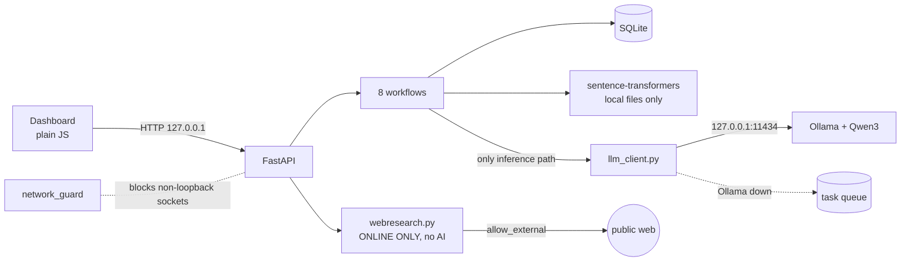

# Architecture

## Separation of AI and web research
* `llm_client.py` is the single inference module. It validates the endpoint (loopback, or private IP with explicit opt-in) and has no other provider code path.
* `webresearch.py` fetches public pages and stores plain text on the prospect row. It never imports the inference client, and workflows never import it. `tests/test_core.py::test_ai_and_web_research_are_separated` enforces both directions.
* `network_guard.py` patches `socket.connect`. Outside `allow_external()` (used only by `webresearch.py`) any non-loopback connection raises and is logged to `var/logs/network_violations.jsonl`.

## Data flow
Company docs -> **profile** -> product + profile -> **ICP** (per product) -> prospect rows with stored text -> **research** -> **signals** -> **problem** -> **score** (needs ICP) -> **email**. Replies -> **classification**. All results are persisted in SQLite so later stages, and offline sessions, read local data only.

## Reliability design
* **Structured output**: every call passes a JSON Schema to Ollama's `format`. Output is parsed, structurally validated, and retried once; a second failure raises `BadModelOutput` (HTTP 502), never a made-up answer.
* **Grounding checks**: quotes returned as "evidence" must appear verbatim in the stored source text. Failures are dropped (research) or cap signal strength at 2 (signals).
* **Prompt-injection posture**: scraped/stored text is wrapped in `<untrusted_data>` tags and the system prompt forbids following instructions inside them. The sample data includes an injection attempt (Pixel & Pine Studio) so you can show it being ignored. This reduces, not eliminates, risk.
* **Email checks**: length, placeholders, name mention, a question, cliché openers; one automatic regeneration with the issues listed. A fixed opt-out line is appended deterministically.

## Failure handling (spec section 6)
| Situation | Behaviour |
|---|---|
| Ollama not running | `OllamaUnavailable` -> task stored in `tasks` table, API returns `status: queued` with a clear message, header chip turns red. **No cloud call is ever attempted.** |
| Ollama returns after outage | Background worker (every 15 s) or "Process queue now" replays tasks in order. |
| Model not pulled | `ModelNotInstalled` with the exact `ollama pull <model>` command. |
| Scoring while down | Deterministic partial score (rules + embeddings + signals) is saved and flagged `partial`; the model-fit part is queued. |
| Replies while down | Opt-outs / out-of-office are classified by rules immediately; others are queued. |
| No internet for web fetch | `503` with "Offline? Local data is still usable." Nothing else is affected. |

## Offline behaviour
After `scripts/download_models.py`, nothing downloads at run time (`HF_HUB_OFFLINE=1`, `local_files_only=True`, Ollama local). Only `POST /api/prospects/{id}/fetch-web` uses the internet, and only when a user clicks it.
